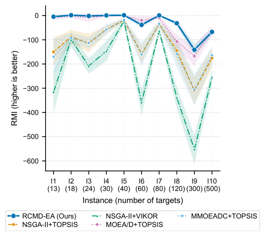
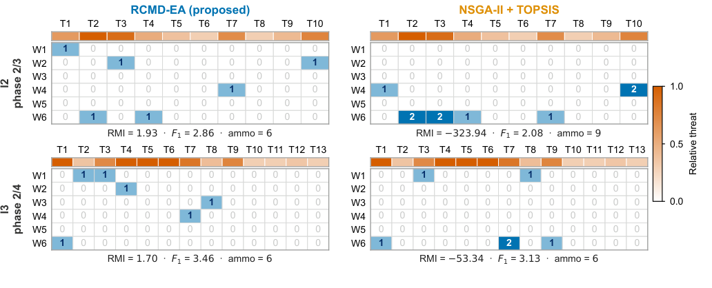
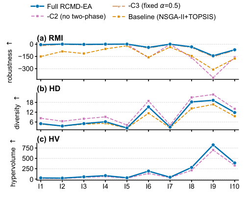
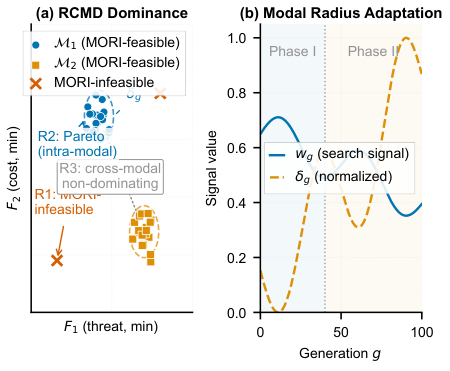

# MO-DWTA: Robust Constrained Multimodal Dominance EA for Multi-objective Dynamic Weapon-Target Assignment

多目标动态武器目标分配（MO-D-POWTA）的鲁棒多模态进化优化方法 —— **RCMD-EA** 的官方开源实现。

> **论文已发表 / Paper Published**: X. Yao, W. Li, T. Zhang, R. Wang, and X. Lu, "Robust Constrained Multimodal Dominance evolution for dynamic weapon-target assignment," *Swarm and Evolutionary Computation*, vol. 110, Article 102583, 2026. DOI: [10.1016/j.swevo.2026.102583](https://doi.org/10.1016/j.swevo.2026.102583)
>
> 论文定稿 PDF：[202611-SWEC-Robust Constrained Multimodal Dominance Evolution for Dynamic Weapon-Target Assignment.pdf](202611-SWEC-Robust Constrained Multimodal Dominance Evolution for Dynamic Weapon-Target Assignment.pdf) · 补充材料：[supplementary.pdf](supplementary.pdf)

**引用 / Citation:**

```bibtex
@article{Yao2026RCMDEA,
  author  = {Yao, Xingyi and Li, Wenhua and Zhang, Tao and Wang, Rui and Lu, Xin},
  title   = {Robust Constrained Multimodal Dominance evolution for dynamic weapon-target assignment},
  journal = {Swarm and Evolutionary Computation},
  volume  = {110},
  pages   = {102583},
  year    = {2026},
  doi     = {10.1016/j.swevo.2026.102583}
}
```

---

## 简介 / Abstract

本项目提供论文 *"Robust Constrained Multimodal Dominance Evolution for Dynamic Weapon-Target Assignment"*（MO-DWTA）中提出的 **RCMD-EA** 算法及其对比算法的 Python 实现，以及论文使用的 `I1`–`I10` 测试实例。

> **2026-09 更新（v2，对应修改稿）**：修复了 Phase II 的预算核算缺陷——初版代码中初始 MORI 评估未经预算检查，可能耗尽评价预算导致深化循环无法执行；v2 采用 budget-aware MORI 采样，严格保证与全部基线相同的 `N × G_max` 评价预算。修改稿报告的全部 4,800 次运行均基于 v2 实现。同步新增 `scripts/`（并行实验驱动、统计分析、论文插图生成）与 `tests/`（单元测试）。

RCMD-EA 的核心贡献包括：

- **C1 — RCMD 支配关系**：三层鲁棒约束多模态支配，兼顾收敛、多样性与鲁棒性。
- **C2 — 双阶段进化框架**：前期 NSGA-II 探索，后期 RCMD 深化。
- **C3 — 态势感知后选择**：基于威胁集中度 `φ_t` 自适应偏好，实现多周期一致决策。
- **零新增用户参数**：所有自适应量由搜索信号 `w_g` 和外部态势信号 `φ_t` 派生。

---

## 安装 / Installation

```bash
git clone https://github.com/Wenhua-Li/MO-DWTA.git
cd MO-DWTA
pip install -r requirements.txt
```

依赖：Python ≥ 3.9，NumPy、SciPy、Matplotlib、Pandas。

---

## 快速开始 / Quick Start

运行 `demo.py` 即可在 `I1` 算例上执行一次 RCMD-EA，并输出关键指标：

```bash
python demo.py
```

示例输出：

```text
Instance: I1
Phases: 2
Final HV (per phase mean): 0.8234
Final PSR: 0.91
Elapsed: 12.3 s
```

---

## 示例结果 / Sample Results

### 收敛性对比 / Convergence



### 分配方案可视化 / Assignment Visualization



### 消融实验 / Ablation Study



### RCMD 支配概念 / RCMD Dominance Concept



---

## 仓库结构 / Repository Structure

```
MO-DWTA/
├── alg_code/          # 核心算法源码
│   ├── rcmd_ea.py     # RCMD-EA 主算法（v2：budget-aware MORI 采样）
│   ├── problems/      # 问题建模与评估
│   └── baselines/     # 对比算法（NSGA-II, MOEA/D, SPEA2, CoMMEA, HDMMODE, MMOEADC）
├── scripts/           # 实验驱动与论文图表生成
│   ├── runner.py      #   算法注册表 + 并行驱动（--workers/--skip-existing）
│   ├── analyze_results.py  # 统计分析（Wilcoxon/Friedman）与表格生成
│   └── gen_revision_figs.py# 论文全部插图与消融明细表生成
├── tests/             # 单元测试（约束满足/RCMD 无环性/RMI 修复验证）
├── instances/         # I1-I10 测试实例
├── assets/            # README 展示用示例图片
├── demo.py            # 快速开始脚本
├── requirements.txt   # Python 依赖
├── LICENSE            # MIT License
├── CITATION.cff       # GitHub 原生引用元数据
├── 202611-SWEC-*.pdf  # 论文定稿（SWEC vol.110, 2026）
└── supplementary.pdf  # 论文补充材料
```

---

## 复现论文实验 / Reproducing the Paper Experiments

```bash
# 烟测：3 实例 × 3 次独立运行
python scripts/runner.py --algo rcmd_v2 --instances I1 I2 I3 --runs 3 --workers 8

# 全量主实验：10 实例 × 30 次（修改稿口径）
python scripts/runner.py --algo rcmd_v2 --instances I1-I10 --runs 30 --workers 8 --skip-existing

# 统计分析与表格生成
python scripts/analyze_results.py
```

---

## 使用 API / API Usage

```python
from alg_code.problems.instance import load_instance
from alg_code.rcmd_ea import run_rcmd_ea, RCMDParams

inst = load_instance("instances/I1.mat")
params = RCMDParams(N_factor=5, G_max=100, runs=1, seed=42)
result = run_rcmd_ea(inst, params)
print(result.metrics)
```

---

## 测试实例 / Benchmarks

| 实例 | 平台数 `m` | 雷达数 `L` | 总目标数 | 阶段数 |
|------|-----------|-----------|---------|--------|
| I1   | 6         | 6         | 24      | 2      |
| I2   | 6         | 6         | 30      | 3      |
| I3   | 6         | 6         | 50      | 4      |
| I4   | 6         | 6         | 100     | 5      |
| I5   | 8         | 6         | 100     | 8      |
| I6   | 8         | 6         | 200     | 5      |
| I7   | 10        | 6         | 200     | 10     |
| I8   | 10        | 8         | 300     | 6      |
| I9   | 10        | 8         | 500     | 8      |
| I10  | 10        | 8         | 500     | 10     |

---

## 许可证 / License

本项目采用 [MIT License](LICENSE)。

---
