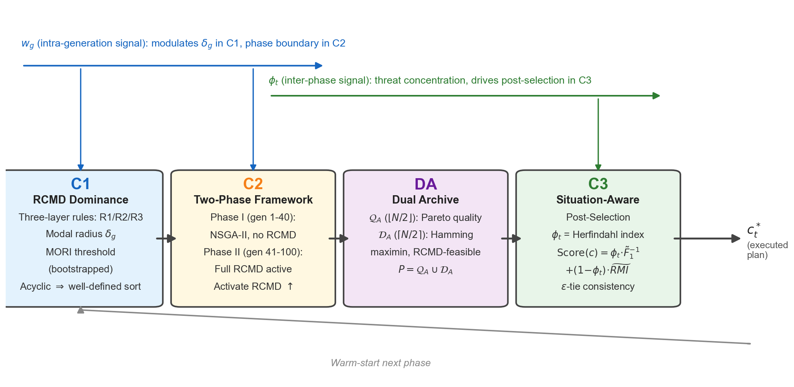

# MO-DWTA: Robust Constrained Multimodal Dominance EA for Multi-objective Dynamic Weapon-Target Assignment

多目标动态武器目标分配（MO-D-POWTA）的鲁棒多模态进化优化方法 —— **RCMD-EA** 的官方开源实现。

---

## 简介 / Abstract

本项目提供论文 *"A Robust Constrained Multimodal Dominance Evolutionary Algorithm for Multi-objective Dynamic Weapon-Target Assignment"*（MO-DWTA）中提出的 **RCMD-EA** 算法及其对比算法的 Python 实现，以及论文使用的 `I1`–`I10` 测试实例。

RCMD-EA 的核心贡献包括：

- **C1 — RCMD 支配关系**：三层鲁棒约束多模态支配，兼顾收敛、多样性与鲁棒性。
- **C2 — 双阶段进化框架**：前期 NSGA-II 探索，后期 RCMD 深化。
- **C3 — 态势感知后选择**：基于威胁集中度 `φ_t` 自适应偏好，实现多周期一致决策。
- **零新增用户参数**：所有自适应量由搜索信号 `w_g` 和外部态势信号 `φ_t` 派生。

---

## 算法框架 / Framework



---

## 安装 / Installation

```bash
git clone https://github.com/Wenhua-Li/MO-DWTA.git
cd MO-DWTA
pip install -r requirements.txt
```

依赖：Python ≥ 3.9，NumPy、SciPy、Matplotlib、Pandas。

---

## 快速开始 / Quick Start

运行 `demo.py` 即可在 `I1` 算例上执行一次 RCMD-EA，并输出关键指标：

```bash
python demo.py
```

示例输出：

```text
Instance: I1
Phases: 2
Final HV (per phase mean): 0.8234
Final PSR: 0.91
Elapsed: 12.3 s
```

---

## 示例结果 / Sample Results

### 收敛性对比 / Convergence


### 分配方案可视化 / Assignment Visualization


### 消融实验 / Ablation Study


### RCMD 支配概念 / RCMD Dominance Concept


---

## 仓库结构 / Repository Structure

```
MO-DWTA/
├── alg_code/          # 核心算法源码
│   ├── rcmd_ea.py     # RCMD-EA 主算法
│   ├── problems/      # 问题建模与评估
│   └── baselines/     # 对比算法（NSGA-II, MOEA/D, SPEA2, CoMMEA, HDMMODE, MMOEADC）
├── instances/         # I1-I10 测试实例
├── assets/            # README 展示用示例图片
├── demo.py            # 快速开始脚本
├── requirements.txt   # Python 依赖
└── LICENSE            # MIT License
```

---

## 使用 API / API Usage

```python
from alg_code.problems.instance import load_instance
from alg_code.rcmd_ea import run_rcmd_ea, RCMDParams

inst = load_instance("instances/I1.mat")
params = RCMDParams(N_factor=5, G_max=100, runs=1, seed=42)
result = run_rcmd_ea(inst, params)
print(result.metrics)
```

---

## 测试实例 / Benchmarks

| 实例 | 平台数 `m` | 雷达数 `L` | 总目标数 | 阶段数 |
|------|-----------|-----------|---------|--------|
| I1   | 6         | 6         | 24      | 2      |
| I2   | 6         | 6         | 30      | 3      |
| I3   | 6         | 6         | 50      | 4      |
| I4   | 6         | 6         | 100     | 5      |
| I5   | 8         | 6         | 100     | 8      |
| I6   | 8         | 6         | 200     | 5      |
| I7   | 10        | 6         | 200     | 10     |
| I8   | 10        | 8         | 300     | 6      |
| I9   | 10        | 8         | 500     | 8      |
| I10  | 10        | 8         | 500     | 10     |

---

## 许可证 / License

本项目采用 [MIT License](LICENSE)。

---

## 引用 / Citation

如果你使用了本代码或测试实例，请引用我们的论文：

```bibtex
@article{li2026modwta,
  title={A Robust Constrained Multimodal Dominance Evolutionary Algorithm for Multi-objective Dynamic Weapon-Target Assignment},
  author={Li, Wenhua},
  journal={...},
  year={2026},
  publisher={...},
  doi={...}
}
```

> 注：期刊、卷号、页码和 DOI 将在论文正式发表后更新。
